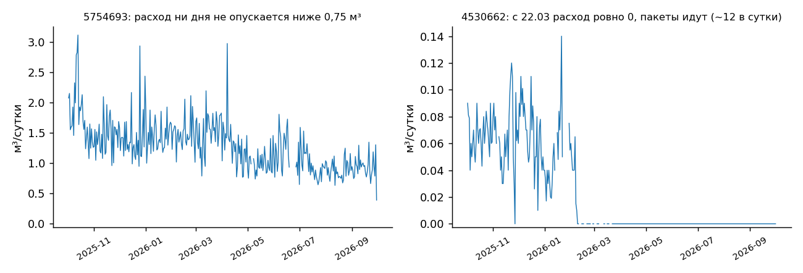
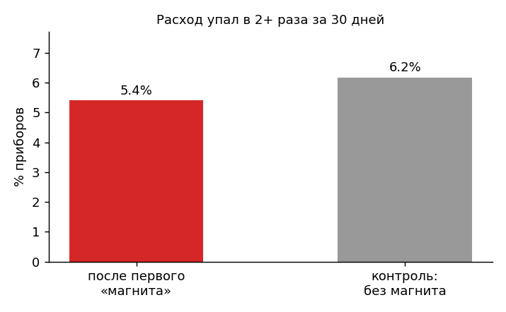
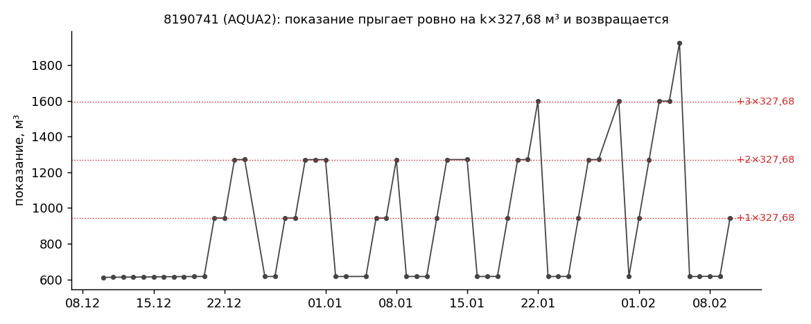

# Аномалии водопотребления — тестовое задание «Вавиот Азия»

Данные: 3 000 приборов, 693 443 суточных показания за 01.10.2025 – 01.10.2026.

## Коротко

- **Почти все «нереальные» расходы — это сбои передачи данных у приборов AQUA2, а не вода.** Показание прыгает ровно на k × 327,68 м³ (327,68 = 2¹⁵ × 10 л) и через несколько дней возвращается. Все 55 приборов с расходом выше паспортного максимума относятся к типу AQUA2. Отсюда же 139 из 190 случаев «отрицательного расхода»: это возврат показания после такого скачка.
- Поэтому сначала я убрал сбойные показания и только потом искал поведенческие аномалии (всплески, утечки, нули, ступеньки). Иначе каждый сбой AQUA2 давал бы ложный всплеск и ложную ступеньку.
- **Связи падения расхода с событием «магнит» в этих данных нет.** После первого «магнита» расход падает в 2+ раза у 5,4 % приборов, в контрольной группе без магнита — у 6,2 %.
- Итог — список из 63 приборов в трёх группах: проверить данные/декодер (31), выехать на объект (28), осмотреть после «магнита» (4). Файл: `results/inspection_list.csv`.

## Запуск

```bash
pip install -r requirements.txt
python analysis.py
```

Исходные CSV лежат в `data/`. Скрипт работает 15–20 секунд, пишет таблицы в `results/` и графики в `charts/`. Все цифры из этого README есть в `results/summary.txt`. Пороги вынесены в начало `analysis.py`, их можно поменять и перезапустить расчёт.

## Как считал суточный расход

1. Сортирую показания по прибору и дате. **Суточный расход = показание дня − показание предыдущего календарного дня.** Если между двумя показаниями был пропуск (74 029 случаев, около 11 %), суточного расхода за эти дни нет. Разницу через пропуск по дням не размазываю, чтобы не выдумывать данные.
2. Округляю расход до литра. Часть показаний пришла с хвостом вида `324.596250` (похоже на среднее по нескольким пакетам за сутки), и без округления появляется «отрицательный расход» −1e-14.
3. **Сбойные показания.** Накопительный счётчик не может уменьшаться. Если показание выпрыгнуло вверх (или провалилось вниз), а потом ряд вернулся к прежнему уровню, сбойное — само это показание (функция `find_glitches`). Если ряд не вернулся (замена или сброс прибора), показание оставляю. Так нашлось 949 сбойных показаний у 81 прибора.
4. Пункты 1 и 3 считаю по **сырому** ряду, как в условии. Пункты 2 и 4–7 — по **очищенному**: без сбойных показаний, без отрицательных значений, без значений выше паспортного максимума и без соседних с ними дней.

Типичный прибор расходует 0,036 м³/сутки (медиана), 90 % суток — меньше 0,32 м³. 31 % суток — ровно ноль.

## Результаты

| № | Аномалия | Критерий | Приборов | Примеры |
|---|---|---|---|---|
| 1 | Отрицательный расход | разница соседних дней < 0 | **79** (190 случаев) | 2491162, 8908023, 2159987 |
| 2 | Всплеск, абсолютный | > 2 м³/сутки | **117** | 8727125, 5433406, 4945470 |
| 2 | Всплеск, относительный | > 10× медианы прошлых 30 дней и ≥ 0,5 м³ | **154** | 8309774, 3608551, 8620255 |
| 3 | Нереальные значения | > паспортного максимума за сутки (D15 — 37,5 м³, D20 — 62,5 м³) | **55** | 2491162, 8908023, 2159987 |
| 4 | Утечка, широкий отбор | ≥ 30 суток подряд без нулевых | **1 168** | — |
| 4 | Утечка, строгий отбор | то же + минимум серии ≥ 50 % её медианы и ≥ 50 л | **133** | 5754693, 5198033, 8438725 |
| 5 | Ноль при живой связи | ≥ 30 суток подряд расход 0, пакеты каждый день | **694** | 9686922, 7558835, 5374718 |
| 6 | Ступенька | 3 месяца подряд в 3+ раза выше/ниже 3 предыдущих | **43** | 4784112, 5723062, 4746469 |
| 7 | Падение после «магнита» | после ≤ 50 % от «до», окна по 30 дней | **4 из 74** | 5490175, 5945886, 7365695 |

Категории пересекаются, складывать числа нельзя.

### 1. Отрицательный расход

190 случаев у 79 приборов, если брать только соседние дни. С разницами через пропуск — 269 у 102. Разобрал, откуда они берутся:

| Что произошло | Случаев | Приборов |
|---|---|---|
| Возврат после сбойного скачка вверх | 139 | 57 |
| Кратковременный провал и возврат | 20 | 16 |
| Шум меньше 10 л | 24 | 14 |
| Уровень не вернулся (сброс/замена прибора) | 7 | 7 |

63 из 79 приборов — AQUA2. Настоящий «счётчик пошёл назад» встречается редко: в основном это либо сбой передачи, либо замена или сброс прибора. Обратный поток таких величин дать не может. Событие «сброс» из `sobytiya.csv` совпадает (±1 день) только с мелкими случаями до 10 л, с крупными откатами — ни разу.

### 2. Всплески

- **Абсолютный порог 2 м³/сутки.** Это примерно в 6 раз больше 90-го перцентиля и для квартиры уже необычно. Найдено 117 приборов. Самые крупные: 8727125 — 29,6 м³ за 23.02.2026, 5433406 — 23,0 м³, 4945470 — 20,3 м³.
- **Относительный порог:** расход больше чем в 10 раз выше медианы *предыдущих* 30 дней (текущий день в базу не входит) и не меньше 0,5 м³. Найдено 154 прибора. Пример — 8309774: при норме 58 л/сутки четыре дня подряд расходовал 9–12 м³ (25–28.12.2025), потом вернулся к норме. Похоже на прорыв.
- Чувствительность: при пороге > 1 / 2 / 3 / 5 м³ получается 320 / 117 / 69 / 35 приборов; при 5× / 10× / 20× — 305 / 154 / 71.

### 3. Нереальные значения

Предел взял из паспорта АКВА (табл. 3, «максимальный объём воды за сутки»): 37,5 м³ для D15 и 62,5 м³ для D20. У 19 приборов модель не указана, для них взял 62,5 м³. Превышений — 299 суток у 55 приборов, **все 55 — AQUA2**. В 278 из 299 случаев показание потом вернулось к прежнему уровню, то есть это сбой, а не расход.

Самые крупные: 2491162 — 3 005 504 м³ за сутки, 8908023 — 2 684 039 м³, 2159987 — 2 835 м³. У 2491162, 2519659 и 8908023 показание больше ёмкости счётного механизма (99 999,9999 м³), то есть физически невозможно.

### 4. Утечка

Если брать условие буквально (≥ 30 суток без единого нулевого дня), получается 1 168 приборов — 39 % всех. Обычная жилая квартира тоже расходует воду каждый день, поэтому такой отбор слишком широкий. Добавил признак, который отличает утечку от жизни: у утечки есть «пол», ниже которого расход не опускается. Строгий критерий: ≥ 30 суток без нулей, самый маленький день серии ≥ 50 % медианы серии и ≥ 50 л. Таких 133 прибора, из них 6 держат это ≥ 90 суток.

Пример — 5754693: 216 суток подряд расход ни разу не опустился ниже 0,75 м³ (медиана 1,4 м³). Для квартиры это много и подозрительно ровно.



Подтвердить утечку по суточным данным нельзя: нужен ночной (часовой) профиль или проверка на месте.

### 5. Нулевой расход при идущих пакетах

694 прибора ≥ 30 суток подряд показывают ровно 0, хотя пакеты приходят каждый день. Таких групп две:

- **Ноль с самого начала** — скорее всего, пустующая квартира. Пример: 9686922, 7558835 — 364 дня по нулям.
- **Расходовал и «замер»** — до начала серии набрал ≥ 1 м³, потом ровно ноль. Таких 59. Это кандидаты на заклинивший счётчик или обход учёта. Примеры: 5374718 (331 сутки, 2 574 пакета), 4530662 и 9302752 (оба по 194 суток с 22.03.2026, оба на BS-07).

По длине серии: ≥ 30 / 60 / 90 / 180 суток — 694 / 348 / 196 / 37 приборов.

### 6. Ступенька

Считаю медиану суточного расхода по месяцам (месяц учитываю, если в нём ≥ 15 дней данных). Ступенька в месяце *k* — если **каждый** из 3 месяцев после в 3+ раза выше **каждого** из 3 месяцев до (или наоборот) и разница не меньше 100 л/сутки. Сравнение «минимум с одной стороны против максимума с другой» отсекает разовый всплеск, который поднял бы среднее за один месяц.

Найдено 43 прибора: 26 с ростом и 17 с падением. Из них 21 случай «ноль → расход» (похоже на заселение) и 16 «расход → ноль» (выезд или остановка счётчика). Примеры: 4784112 — с 0,61 до 0 м³/сутки с января 2026; 5723062 — с 0,013 до 0,56 с мая 2026.

Вариант прямо из условия (средний расход второй половины года против первой, ≥ 3×) даёт 59 приборов с ростом и 12 с падением, но он ловит и одиночные всплески, поэтому основным оставил помесячный.

### 7. Магнит

Повторы одной тревоги за день убрал: осталось 10 164 пары «прибор-день» у 671 прибора. Проверил тремя способами:

1. **До/после первого магнита.** 30 дней до и 30 после, нужно ≥ 15 дней данных с каждой стороны и расход до ≥ 50 л/сутки. Оценить удалось 74 прибора. У остальных первый магнит пришёлся в основном на сентябрь 2026 (376 из 671), и данных «после» ещё нет. Падение в 2+ раза — у 4 (5,4 %): 1297392, 5490175, 5945886, 7365695.
2. **Контрольная группа.** Приборы тех же типов без магнита, та же проверка на случайную дату. Падение у 6,2 %, то есть столько же.
3. **По дням.** У «магнитных» приборов в дни с событием средний расход 0,153 м³, в остальные дни — 0,154 м³. Доля нулевых суток немного выше: 35 % против 28 %.



Вывод: в целом магнит с падением расхода не связан. Четыре прибора стоит осмотреть точечно. Отдельно: у AQUA2 нет ни одного события любого типа, хотя все крупные сбои — именно у них. Система событий эту проблему не видит.

### 8. Свои находки

**8.1. Сбои AQUA2 кратны 327,68 м³.** Из 424 суточных скачков больше 50 м³ ровно 301 кратен 327,68 м³ (± 1 м³). Это 52 прибора, все AQUA2 (13 % парка AQUA2). Чаще всего k = 1 (228 раз), но бывает и 2, 3, 4. 327,68 м³ = 2¹⁵ × 10 л — похоже, в старшем разряде счётчика или при декодировании пакета теряется/добавляется бит. Это проблема данных, а не потребления, и решать её нужно в декодере: ошибку можно исправить автоматически, вычтя k × 327,68.



**8.2. 17.10.2025 у шести AQUA2 показание выросло ровно в 10 раз** (2159987, 2983464, 7726046, 7891133, 8148916, 8973572): например, 314,83 → 3 149,6. За 1–4 дня всё вернулось к прежнему уровню. Одна дата и один множитель у разных приборов — это сдвиг запятой при обработке данных за конкретный день, а не 2 800 м³ воды.

**8.3. Одно и то же фантомное показание у разных приборов.** У 7 приборов aqua2_nvt_wa_stm (6 из них на BS-04) показание на один день становится ровно 0,534, а на следующий возвращается к 0,032. Ещё у 1063500 то же самое держалось два дня. Одинаковое значение у разных приборов — признак ошибки прошивки или конфигурации, а не расхода 0,5 м³.

Для справки, чтобы не принять за аномалию: 254 прибора появились в данных только в сентябре 2026 (218 из них на BS-02, выпуск июль–август 2026). Это новая партия, а не потеря связи.

## Кого проверять первым

`results/inspection_list.csv` — 63 прибора, у каждого указаны причина и что именно проверить.

1. **Данные и декодер, без выезда (31):** 2491162, 8908023, 2519659 (показания в миллионы м³); шесть приборов с ×10 за 17.10.2025; 10 AQUA2 с самыми частыми сбоями 327,68 (8190741, 9487974, 2030325, 7293232, 6949939 …); 7 приборов с фантомом 0,534; 5 приборов, у которых показание упало и не вернулось (был ли акт замены?).
2. **Выезд (28):** утечка с «полом» ≥ 90 суток — 5754693, 5198033, 8438725, 2188349, 4196861, 1167943; «замерли» на 180+ суток — 5374718, 4530662, 9302752; 19 приборов с 3+ сутками подряд выше нормы в 10+ раз (8309774, 3036541, 5723062 …).
3. **Осмотр после «магнита» (4):** 1297392, 5490175, 5945886, 7365695.

## Что бы сделал дальше

- Сверить сбои AQUA2 с сырыми пакетами. Если гипотеза про 2¹⁵ подтвердится, исправлять показания в декодере, а не чистить их в аналитике.
- Для утечек нужны часовые данные: минимальный ночной расход надёжнее суточного «пола».
- Запускать этот же скрипт ежедневно по новым данным: в пунктах 2 и 6 база считается только по прошлому, так что их можно использовать как оперативные алерты.

## Файлы

| Файл | Что внутри |
|---|---|
| `analysis.py` | весь расчёт |
| `results/summary.txt` | все цифры прогона |
| `results/daily_consumption.csv.gz` | суточный расход по каждому прибору: сырой, очищенный и флаг сбоя |
| `results/1_negative.csv` … `results/8_*.csv` | детали по каждому пункту |
| `results/inspection_list.csv` | очередь на проверку |
| `charts/` | графики |
